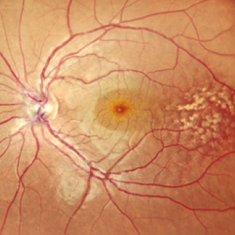
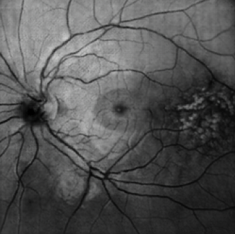
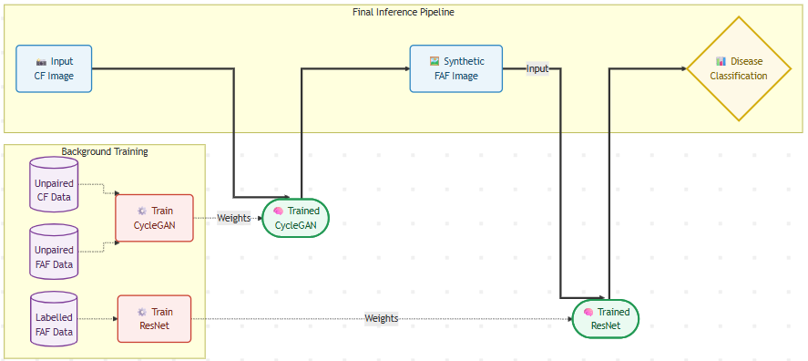
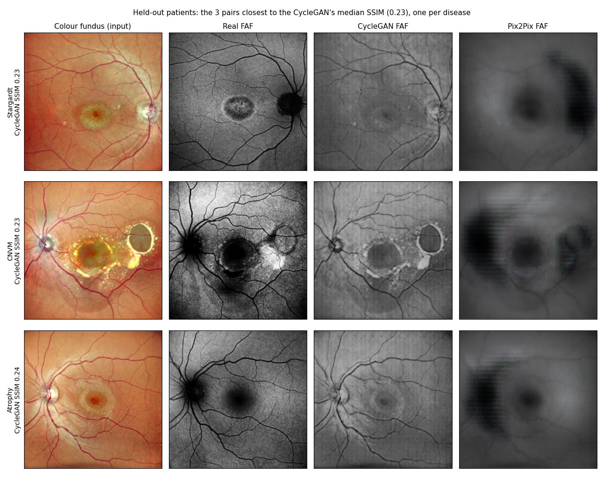
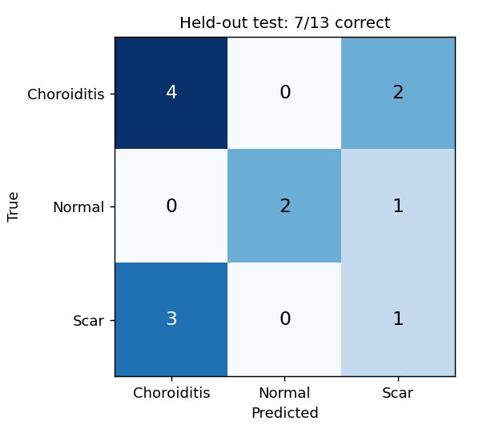
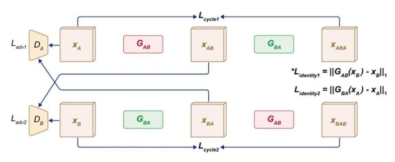

# RetinalAI: Synthetic FAF Images from Colour Fundus Photos

<div align="center">


**A B.E. final-year project: a CycleGAN turns a colour fundus photo into a synthetic fundus autofluorescence (FAF) image, a ResNet-18 classifies the synthetic FAF, and a Streamlit app runs both with a Grad-CAM heatmap. A proof of concept on a small hospital dataset, tested on patients the models never saw.**

[Pipeline](#pipeline) · [Data](#data-and-the-held-out-test-set) · [Results](#results-on-held-out-patients) · [Getting Started](#getting-started) · [Project Structure](#project-structure) · [How It Works](#how-it-works)

</div>

---

## The Problem

**Fundus autofluorescence (FAF)** imaging shows changes in the retinal pigment epithelium that a colour photo doesn't, which helps with diseases such as Stargardt disease, AMD and choroiditis. It needs a confocal scanning laser ophthalmoscope, which many clinics don't have. **Colour fundus (CF)** cameras are far more common.

This project asks whether a model can learn to produce the FAF view from the colour photo, and whether a classifier can work from that synthetic FAF.

<div align="center">
  <table>
    <tr>
      <td align="center"><b>Input: colour fundus (CF)</b></td>
      <td align="center"><b>Output: synthetic FAF</b></td>
    </tr>
    <tr>
      <td></td>
      <td></td>
    </tr>
  </table>
  <em>A held-out test photo (Stargardt disease) and the CycleGAN's output for it. The model never saw this patient; the pair is the one closest to its median score</em>
</div>

---

## Pipeline

<div align="center">
  
  <br>
  <em>Training (bottom left) and inference (top). The ResNet trains on synthetic FAFs made from labelled CF photos. In the app, a Grad-CAM heatmap shows where the classifier looked.</em>
</div>

<br>

A low-cost capture device (3D-printed scope, 20D lens, LED and camera) was planned but never built. Every image in this project comes from the hospital datasets.

---

## Data and the Held-Out Test Set

- **Images:** two hospital datasets. The main one has 259 paired CF/FAF photos across 17 diseases; the second adds unpaired photos. The CycleGAN trains on a separate folder of 624 unpaired CF and FAF files. The data is not public.
- **Patients:** the file names carry no patient IDs, so photos were grouped by patient using the original hospital files. A patient's left and right eye count as one patient. 106 patients in 7 diseases got a patient code. 65 pairs from 10 rarer diseases have none, so they are only ever used for training.
- **Held-out test set:** 22 patients (20% of each disease, fixed seed 2026). Their photos were removed from every training set. Some photos had been re-saved under other names, so photos were also matched by their blood-vessel pattern (SIFT + RANSAC), which is unique to each eye. That found 8 more copies of test patients' eyes, which were removed too.
- **Classifier set:** 62 CF photos in 3 classes (Choroiditis 27, Normal 13, Scar 22). Training: 49 photos from 26 patients. Test: 13 photos from 7 patients.

The split lists are in [`Dataset/Splits/`](Dataset/Splits) and the code that makes them is [`evaluation/Step1_Patient_Split.py`](evaluation/Step1_Patient_Split.py).

---

## Results on Held-Out Patients

**In short:** on patients the models never saw, Pix2Pix reproduces the real FAF more closely than the CycleGAN on every pixel score, a blurry average image beats both on SSIM, and the classifier is close to guessing, with or without the GAN step.

### CF → FAF translation (39 test pairs from 20 patients)

| Model | SSIM | PSNR | MAE |
| ----- | ---- | ---- | --- |
| CycleGAN, trained without the test patients | 0.258 | 14.07 dB | 0.168 |
| Pix2Pix, trained without the test patients | 0.324 | 17.40 dB | 0.113 |
| Baseline: one fixed image, the average training FAF | 0.372 | 17.48 dB | 0.113 |
| Baseline: a grey copy of the CF photo | 0.237 | 10.69 dB | 0.256 |

SSIM, PSNR and MAE compare the images pixel by pixel. A blurry average image already scores well on them, because they punish a sharp detail in slightly the wrong place more than they punish blur. So this table shows how closely each model reproduces the real FAF pixel by pixel. It cannot show whether the synthetic FAF carries the right clinical detail. Resampling the 20 test patients puts the CycleGAN's SSIM between 0.22 and 0.30 and Pix2Pix's between 0.27 and 0.38 (95% range).

<div align="center">
  
  <br>
  <em>Test patients the models never saw: the three pairs closest to the CycleGAN's median score, one per disease</em>
</div>

<br>

In these examples the CycleGAN keeps the colour photo's structure (vessels, lesion outlines) and changes its tone, but it doesn't reproduce FAF-specific signs such as the dark optic disc, the dark macula or the ring in Stargardt disease. Pix2Pix gets the typical FAF layout (dark disc and macula) but blurs the detail away, which is why it scores higher.

### Classification: Choroiditis, Normal or Scar

| Input to the classifier | Cross-validation on the 26 training patients | Test on the 13 held-out photos |
| ----------------------- | -------------------------------------------- | ------------------------------ |
| Synthetic FAF from the CycleGAN | 40.0% | 53.8% (7/13) |
| The real CF photo, no GAN | 46.9% | 38.5% (5/13) |
| Always answering "Choroiditis" | 42.9% | 46.2% (6/13) |

Cross-validation is patient-grouped, 5 folds, averaged over 5 seeds. The test set was used once, after all choices were fixed.

<div align="center">
  
</div>

Both versions are close to always answering the largest class, so the GAN step neither helps nor hurts the classifier here. With 13 test photos, each photo moves accuracy by 7.7 percentage points, so treat the test numbers as rough.

---

## Getting Started

### Prerequisites

- Python 3.12 (the runs here used PyTorch 2.5.1 and 2.6.0)
- A CUDA GPU is recommended (it also runs on CPU, more slowly)

### Installation

```bash
git clone https://github.com/AshutoshBhate/RetinalAI.git
cd RetinalAI
pip install -r requirements.txt
```

### Data and weights

The hospital data and the trained weights are not in this repo. The scripts in `evaluation/` expect this layout under the repo root:

```
Dataset/Actual_Original_Master/<disease>/CF_*.jpg, FAF_*.jpg   (paired photos)
Dataset/CycleGAN_Data_Unpaired_CF-FAF/{CF,FAF}/                 (unpaired photos)
Dataset/Final_Merged_CF_Renumbered/{Choroiditis,Normal,Scar}/   (classifier photos)
Dataset/Splits/                                                 (included)
```

### Reproducing the results

Run the scripts in `evaluation/` in order:

| Script | What it does |
| ------ | ------------ |
| `Step1_Patient_Split.py` | Groups photos by patient and writes the split lists |
| `Step2_Old_Classifier_CV.py` | Scores the original classifier recipe with patient-grouped cross-validation |
| `Step3_Train_CycleGAN_TrainOnly.py` | Trains the CycleGAN without the test patients |
| `Step4_Train_Pix2Pix_TrainOnly.py` | Trains Pix2Pix without the test patients |
| `Step5_Score_GANs.py` | Scores both GANs and the baselines on the 39 test pairs |
| `Step6_Generate_FAF_TrainOnly.py` | Makes synthetic FAFs for the 62 classifier photos |
| `Step7_Classifier_TrainOnly.py` | Trains and tests the classifier |
| `Step8_Figures.py` | Draws the figures above |

The scripts also need `scikit-learn`, `scikit-image` and `matplotlib`, and Step 4 needs `albumentations` (`pip install scikit-learn scikit-image matplotlib albumentations`). Step 1 also needs the patient lists made from the original hospital files, which are not included. The outputs of my runs are in `evaluation/Results/`.

### Run the demo

```bash
streamlit run app/Whole_Pipeline.py
```

The app looks for `cycleGAN_Weights_TrainOnly/G_AB_95.pth` and `Codes/Training/Training_3_classes_TrainOnly/resnet_faf_classifier.pth` under the repo root. If the photos are present, its dataset picker offers only the 13 held-out test photos. On those, the app gets 8 of 13 right rather than 7, because it classifies the synthetic FAF straight from memory, while the test classified the saved JPEG.

---

## Project Structure

```
RetinalAI/
├── README.md
├── requirements.txt
├── app/
│   └── Whole_Pipeline.py           Streamlit demo: CF → FAF → class → Grad-CAM
├── evaluation/
│   ├── Networks.py                 Generator and discriminators
│   ├── Step1 ... Step8             The scripts listed above
│   └── Results/                    Scores, training logs and figures from my runs
├── Dataset/Splits/                 Patient split lists
├── notebooks/
│   ├── cyclegan/                   CycleGAN training, translation and metrics notebooks
│   └── resnet/                     ResNet-18 training and evaluation notebooks
└── images/                         Figures for this README
```

The notebooks are the project's exploration notebooks (CycleGAN training on Kaggle, translation, metrics and ResNet training). The results above come from the scripts in `evaluation/`.

---

## How It Works

### Stage 1: CycleGAN (unpaired CF → FAF)

<div align="center">
  
  <br>
  <em>Two generators (G_AB: CF → FAF, G_BA: FAF → CF) and two discriminators, trained with adversarial and cycle-consistency losses. The identity loss (marked *) was switched off.</em>
</div>

<br>

| Component | Details |
| --------- | ------- |
| **Generators** | U-Net, 48 base features, BatchNorm, dropout in the first 3 decoder blocks |
| **Discriminators** | PatchGAN with InstanceNorm, 16×16 output map |
| **Losses** | Least-squares GAN loss + cycle-consistency L1 (λ = 5); identity loss off |
| **Training data** | 261 CF + 256 FAF files after removing the test patients |
| **Augmentation** | Resize to 286, random crop to 256, horizontal flip |
| **Training** | 96 epochs (0–95), batch size 1, Adam lr 2e-4; weights from epoch 95, fixed in advance |
| **Time** | 1 h 04 min on a laptop RTX 3050 |

### Pix2Pix (the paired comparison)

| Component | Details |
| --------- | ------- |
| **Generator** | The same U-Net as the CycleGAN |
| **Discriminator** | Conditional PatchGAN that sees the CF and the FAF together, 26×26 output map |
| **Losses** | GAN loss (BCE) + L1 to the real FAF (λ = 100) |
| **Training data** | 188 paired photos; 32 more pairs from 16 training patients pick the best epoch |
| **Training** | AdamW lr 2e-4 with cosine restarts, batch size 4, flips, ±40° rotation and colour jitter; best at epoch 11, stopped at epoch 41 |

### Stage 2: ResNet-18 classifier

| Component | Details |
| --------- | ------- |
| **Base model** | ResNet-18 pretrained on ImageNet |
| **Training** | Backbone frozen; only the final layer, `nn.Linear(512, 3)`, is trained |
| **Data** | Synthetic FAFs of the 49 training photos |
| **Settings** | Adam lr 5e-4, batch size 8, 40 epochs, flip and ±10° rotation |

### Stage 3: Grad-CAM

Grad-CAM uses the classifier's gradients at `layer4` to make a 7×7 map of the image regions that pushed it towards its answer, upscaled to the image size. It shows where the classifier looked. It is not a segmentation of the disease, and with a classifier this weak it should not be read as one.

---

## Limitations

- **Small data.** 22 test patients for the GANs and 13 test photos for the classifier.
- **Labels per patient.** The hospital labels both eyes with the patient's diagnosis, so some "Choroiditis" photos show the patient's unaffected eye and look normal. Per-eye labels would need an ophthalmologist.
- **One source.** All photos come from the same hospital datasets. There is no external test set.
- **Pixel metrics.** SSIM and PSNR can't judge whether a synthetic FAF is clinically useful. That needs ophthalmologists to grade the images.
- **No hardware.** The capture device was planned, not built.

---

## License

MIT License. See [LICENSE](LICENSE).

## Acknowledgments

- Data from collaborating ophthalmologists
- CycleGAN: [Zhu et al., ICCV 2017](https://arxiv.org/abs/1703.10593)
- Pix2Pix: [Isola et al., CVPR 2017](https://arxiv.org/abs/1611.07004)
- Grad-CAM: [Selvaraju et al., ICCV 2017](https://arxiv.org/abs/1610.02391)

---

<div align="center">
  <b>Built as a B.E. Final Year Project</b>
  <br>
  <em>AI-Based Macular Disease Detection and Classification Using Hardware Platform</em>
</div>
