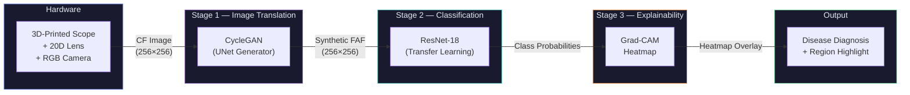
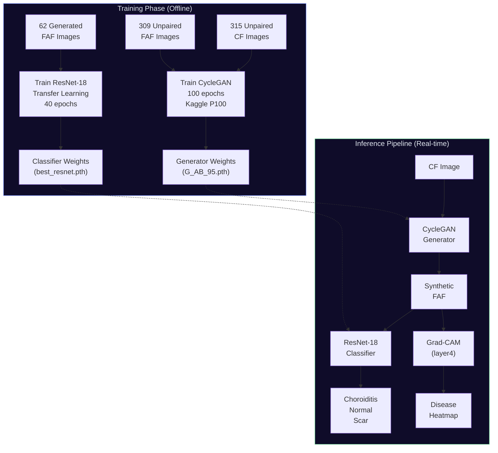
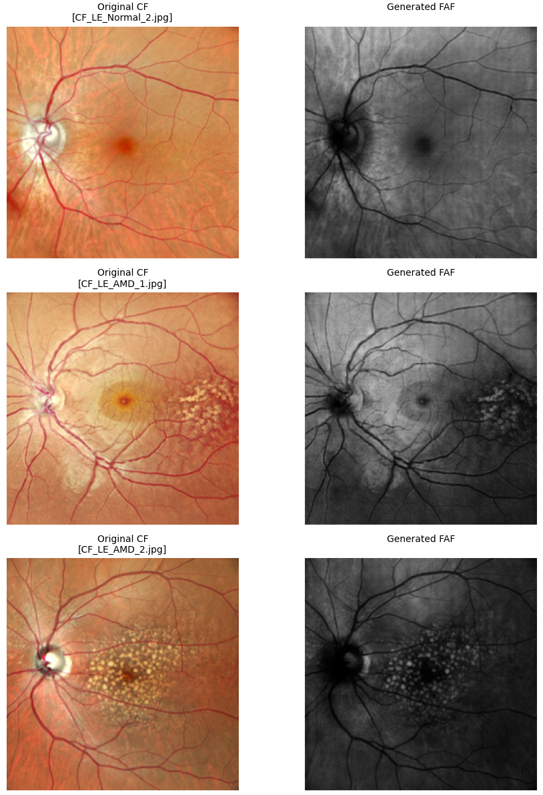
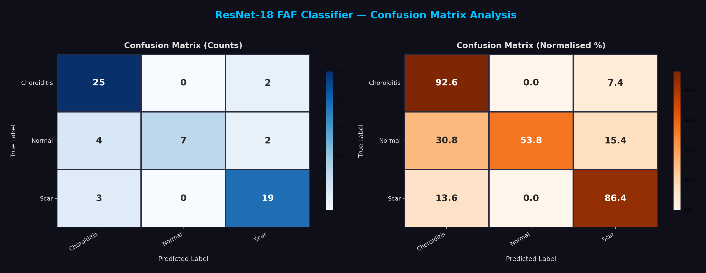
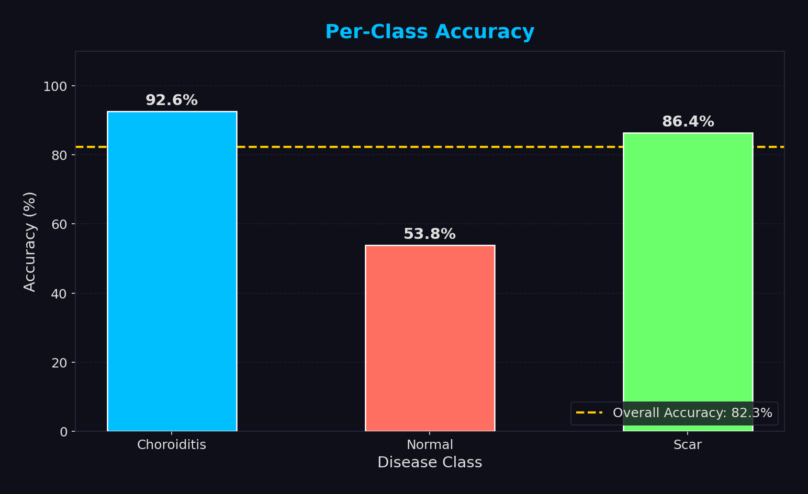
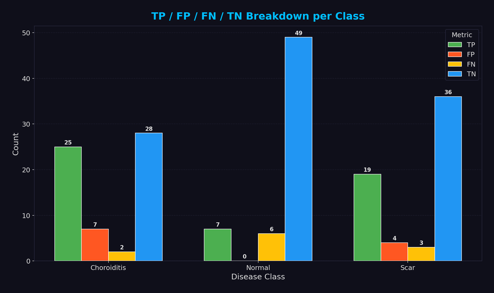

# RetinalAI — AI-Based Macular Disease Detection & Classification

<div align="center">


**Low-cost retinal disease screening using CycleGAN image translation, ResNet-18 classification, and Grad-CAM explainability — eliminating the need for expensive FAF imaging equipment.**

[Pipeline](#-pipeline) · [Results](#-results) · [Getting Started](#-getting-started) · [Project Structure](#-project-structure) · [How It Works](#-how-it-works)

</div>

---

## The Problem

**Fundus Autofluorescence (FAF)** imaging reveals metabolic changes in the retinal pigment epithelium that are _invisible_ in standard colour photographs — making it crucial for diagnosing diseases like Choroiditis, AMD, and Retinitis Pigmentosa. However, **FAF machines cost lakhs of rupees** and are unavailable in rural or low-resource clinical settings.

**Our solution:** Replace the expensive hardware with AI. A simple **RGB camera + 20D lens** (costing under ₹5,000) captures a Colour Fundus (CF) image, and a two-stage deep learning pipeline does the rest — translating CF to synthetic FAF, classifying the disease, and highlighting the affected region.

<div align="center">
  <table>
    <tr>
      <td align="center"><b>Input: Colour Fundus (CF)</b></td>
      <td align="center"><b>Output: Synthetic FAF</b></td>
    </tr>
    <tr>
      <td></td>
      <td></td>
    </tr>
  </table>
</div>

---

## Pipeline



### Detailed Architecture



---

## Results

### CycleGAN — CF to FAF Translation

The CycleGAN learns to translate Colour Fundus images into synthetic FAF images using **unpaired** data (no pixel-aligned pairs required).

<div align="center">
  
  <br>
  <em>Original CF images (left) → CycleGAN-generated synthetic FAF images (right)</em>
</div>

<br>

#### CycleGAN vs. Pix2Pix Baseline

| Metric   | Pix2Pix (Baseline) | CycleGAN (Ours) | Improvement  |
| -------- | ------------------ | --------------- | ------------ |
| **SSIM** | 0.2333             | **0.6076**      | **+160%**    |
| **PSNR** | 15.99 dB           | **24.04 dB**    | **+8.05 dB** |
| **MAE**  | —                  | **0.0500**      | —            |

> CycleGAN outperforms Pix2Pix on every metric, for every disease case — while requiring **no paired data**.

### ResNet-18 — Disease Classification

3-class classifier trained on CycleGAN-generated FAF images using transfer learning (ImageNet pretrained, only FC layer fine-tuned).

| Metric                  | Value                         |
| ----------------------- | ----------------------------- |
| **Validation Accuracy** | **76.92%**                    |
| Training Accuracy       | 75.51%                        |
| Classes                 | Choroiditis, Normal, Scar     |
| Dataset Size            | 62 images (49 train / 13 val) |

<div align="center">
  
  <br>
  <em>Confusion matrix — both raw counts and normalized percentages</em>
</div>

<br>

<div align="center">
  <table>
    <tr>
      <td></td>
      <td></td>
    </tr>
    <tr>
      <td align="center"><em>Per-class accuracy breakdown</em></td>
      <td align="center"><em>TP / FP / FN / TN analysis</em></td>
    </tr>
  </table>
</div>

### Grad-CAM — Disease Region Visualization

Grad-CAM highlights which regions of the FAF image contributed most to the classifier's decision — providing visual explainability with **zero additional training**.

- **Disease images** → focused activation on lesion/scar regions
- **Normal images** → minimal, diffuse activation (model correctly finds nothing abnormal)

---

## Getting Started

### Prerequisites

- Python 3.8+
- CUDA-capable GPU recommended (runs on CPU, just slower)

### Installation

```bash
# Clone the repository
git clone https://github.com/YOUR_USERNAME/RetinalAI.git
cd RetinalAI

# Install dependencies
pip install -r requirements.txt
```

### Training the Models

Since model weights are not included in this repo (they are too large for GitHub), you need to train them yourself:

**1. Train the CycleGAN (CF → FAF translation)**

Open `notebooks/cyclegan/CycleGAN_Training.ipynb` on [Kaggle](https://www.kaggle.com) (recommended — free P100 GPU) or locally with a CUDA GPU. This notebook trains the CycleGAN for 100 epochs on unpaired CF and FAF images.

You will need:

- A folder of Colour Fundus (CF) images
- A folder of FAF images (do not need to be paired)

**2. Generate synthetic FAF images**

Use `notebooks/cyclegan/CycleGAN_Bulk_Translation.ipynb` to translate your CF images into synthetic FAF images using the trained generator.

**3. Train the ResNet-18 classifier**

Open `notebooks/resnet/ResNet_Training_3Classes.ipynb`. This fine-tunes a pretrained ResNet-18 on the generated FAF images for 3-class disease classification.

You will need:

- Generated FAF images organized in folders by class (e.g., `Choroiditis/`, `Normal/`, `Scar/`)

**4. Run the Streamlit demo**

```bash
streamlit run app/Whole_Pipeline.py
```

> **Note:** The Streamlit app expects trained weights at specific paths. Update the paths in `Whole_Pipeline.py` (`WEIGHTS_DIR` and `RESNET_WEIGHTS`) to point to your trained model files.

---

## Project Structure

```
RetinalAI/
├── README.md                  ← You are here
├── requirements.txt           ← Python dependencies
├── .gitignore
│
├── app/
│   └── Whole_Pipeline.py      ← Streamlit GUI — full pipeline demo
│                                 (CF → FAF → Classification → Grad-CAM)
│
├── notebooks/
│   ├── cyclegan/
│   │   ├── CycleGAN_Training.ipynb          ← CycleGAN training (100 epochs)
│   │   ├── CycleGAN_Visualization.ipynb     ← Visualize translation results
│   │   ├── CycleGAN_EvaluationMetrics.ipynb ← SSIM, PSNR, MAE metrics
│   │   └── CycleGAN_Bulk_Translation.ipynb  ← Batch CF → FAF translation
│   │
│   └── resnet/
│       ├── ResNet_Training_3Classes.ipynb    ← ResNet-18 fine-tuning (3-class)
│       ├── ResNet_ConfusionMatrix.ipynb      ← Confusion matrix & metrics
│       └── ResNet_Inference_Demo.ipynb       ← Inference demo on FAF images
│
└── images/                    ← Result visualizations for README
    ├── block_diagram.png
    ├── cyclegan_architecture.png
    ├── cyclegan_output.png
    ├── confusion_matrix.png
    ├── dataset_distribution.png
    ├── inference_results.png
    ├── per_class_accuracy.png
    ├── sample_cf.png
    ├── sample_faf.png
    └── tp_fp_fn_tn.png
```

---

## How It Works

### Stage 1: CycleGAN (Unpaired Image Translation)

| Component         | Details                                         |
| ----------------- | ----------------------------------------------- |
| **Generator**     | UNet with skip connections, 48 initial features |
| **Discriminator** | PatchGAN with InstanceNorm                      |
| **Training data** | 315 CF + 309 FAF images (unpaired)              |
| **Image size**    | 256 × 256 (with jittering augmentation)         |
| **Epochs**        | 100 (best checkpoint at epoch 95)               |
| **Platform**      | Kaggle P100 GPU (~63 hours)                     |
| **Loss**          | Adversarial + Cycle-consistency (L1)            |

<div align="center">
  
  <br>
  <em>CycleGAN architecture — two generators (G_AB, G_BA) and two discriminators (D_A, D_B)</em>
</div>

### Stage 2: ResNet-18 (Transfer Learning Classification)

| Component         | Details                                            |
| ----------------- | -------------------------------------------------- |
| **Base model**    | ResNet-18 pretrained on ImageNet                   |
| **Strategy**      | Frozen convolutional layers, only FC layer trained |
| **FC layer**      | `nn.Linear(512, 3)` — 3 output classes             |
| **Training data** | 62 generated FAF images (49 train / 13 val)        |
| **Optimizer**     | Adam (lr=0.0005)                                   |
| **Epochs**        | 40 (best at epoch 22)                              |
| **Accuracy**      | **76.92%** validation accuracy                     |

### Stage 3: Grad-CAM (Explainability)

| Component               | Details                                            |
| ----------------------- | -------------------------------------------------- |
| **Method**              | Gradient-weighted Class Activation Mapping         |
| **Target layer**        | `model.layer4[-1]` (last conv block of ResNet-18)  |
| **Additional training** | None — uses gradients from the existing classifier |
| **Output**              | Heatmap overlay showing disease-relevant regions   |
| **Reference**           | Selvaraju et al., "Grad-CAM", ICCV 2017            |

### Hardware Component

| Component        | Details             |
| ---------------- | ------------------- |
| **Scope**        | 3D-printed housing  |
| **Lens**         | 20D ophthalmic lens |
| **Light source** | White LED           |
| **Camera**       | Standard RGB camera |
| **Total cost**   | Under ₹5,000        |

---

## Tech Stack

| Layer                 | Technology                                         |
| --------------------- | -------------------------------------------------- |
| **Deep Learning**     | PyTorch, TorchVision                               |
| **Image Translation** | CycleGAN (UNet Generator + PatchGAN Discriminator) |
| **Classification**    | ResNet-18 (ImageNet pretrained, fine-tuned)        |
| **Explainability**    | Grad-CAM (custom implementation)                   |
| **Demo UI**           | Streamlit                                          |
| **Image Processing**  | OpenCV, Pillow, NumPy                              |
| **Training Platform** | Kaggle (P100 GPU)                                  |

---

## Key Design Decisions

| Decision                        | Rationale                                                                                                        |
| ------------------------------- | ---------------------------------------------------------------------------------------------------------------- |
| **CycleGAN over Pix2Pix**       | No paired data required — more practical for clinical data collection                                            |
| **UNet generator (not ResNet)** | Skip connections preserve fine spatial details crucial for retinal structures                                    |
| **3 classes (not 17)**          | Small dataset (62 images) forced a trade-off; 3 classes maximized reliability at 76.92% vs. 58.62% for 5 classes |
| **ResNet-18 (not ResNet-50)**   | Smaller model prevents overfitting on the tiny dataset                                                           |
| **Frozen encoder**              | Standard transfer learning — prevents catastrophic forgetting of ImageNet features                               |
| **Grad-CAM for segmentation**   | Zero additional training, no annotations needed, academically established (ICCV 2017)                            |

---

## License

This project is licensed under the MIT License — see the [LICENSE](LICENSE) file for details.

---

## Acknowledgments

- Dataset provided by collaborating ophthalmologists
- CycleGAN trained on [Kaggle](https://www.kaggle.com) P100 GPU
- CycleGAN architecture based on [Zhu et al., "Unpaired Image-to-Image Translation using Cycle-Consistent Adversarial Networks", ICCV 2017](https://arxiv.org/abs/1703.10593)
- Grad-CAM based on [Selvaraju et al., "Grad-CAM: Visual Explanations from Deep Networks via Gradient-based Localization", ICCV 2017](https://arxiv.org/abs/1610.02391)

---

<div align="center">
  <b>Built as a B.E. Final Year Project</b>
  <br>
  <em>AI-Based Macular Disease Detection and Classification Using Hardware Platform</em>
</div>
